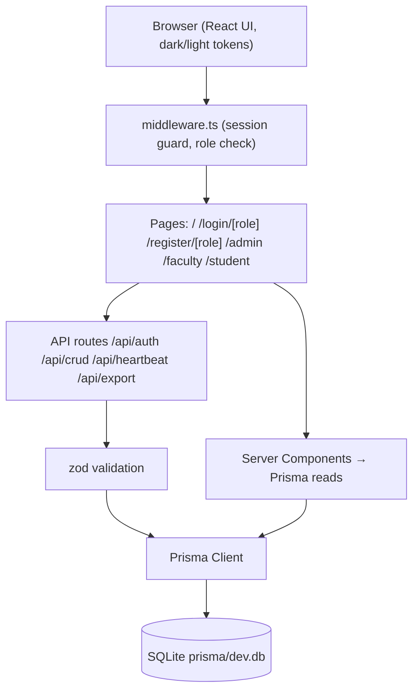

# ARCHITECTURE — Rebuilt System (Next.js + Prisma + SQLite)

_Run: 2026-10-14-sqlite-prisma-ui-unification · Owner: Team Leader_

## 1. System Overview

Single **Next.js App Router** application (TypeScript, `src/` directory) replacing the legacy PHP tree. Data layer is **Prisma ORM over SQLite** (file `prisma/dev.db`). UI is React server components + minimal client components, styled with **Tailwind CSS** driven by one design-token layer supporting dark/light themes.

## 2. Layer Boundaries & File Ownership

| Layer | Path | Owner |
| :--- | :--- | :--- |
| Prisma schema + migrations + seed | `prisma/schema.prisma`, `prisma/seed.ts` | backend |
| DB client singleton | `src/lib/db.ts` | backend |
| Auth/session (JWT cookie via `jose`, guards) | `src/lib/auth.ts`, `middleware.ts` | backend |
| Domain logic (`statusFunc`, `getQuarter` ports) | `src/lib/status.ts`, `src/lib/semester.ts` | backend (ports) / shared |
| API routes (auth, CRUD, heartbeat, export) | `src/app/api/**` | backend |
| Design tokens + theme system | `src/app/globals.css`, `src/components/theme*` | frontend |
| Pages & UI components | `src/app/(pages)/**`, `src/components/**` | frontend |
| Docs & gates | `docs/` | Team Leader |

**Rule:** neither agent edits the other's paths. Shared types live in `src/lib/types.ts` (backend-authored, frontend consumes).

## 3. Data Model (Prisma → SQLite)

Normalized replacement for the 8 legacy tables; relationships move from name-convention to real foreign keys.

- **User** `id, username @unique, passwordHash, role (ADMIN|FACULTY|STUDENT), facultyProfile? (1:1 optional)`
- **FacultyProfile** `id, name @unique, academicRank, advisory, lastHeartbeat DateTime?, userId? @unique`
- **Block** `id, name @unique, yearLevel`
- **Subject** `id, description @unique`
- **Room** `id, name @unique`
- **Schedule** `id, semester, startTime, endTime, days String ("MON,TUE,..." subset of MON..SUN), facultyId→FacultyProfile, blockId→Block, subjectId→Subject, roomId→Room`
- **RosterEntry** `id, name, blockId→Block` (legacy `exprimental_studentlist`; name kept as `RosterEntry`)

Legacy day color columns (`Monday…Sunday` holding `green`/`red`) are replaced by the `days` string list; status color is **computed** (FR-021), never stored.

## 4. Auth & Session Flow

1. `POST /api/auth/login {role, username, password}` → verify `User` (bcryptjs) → sign JWT (`jose`, HS256, `AUTH_SECRET`) → set cookie `rsu_session` (httpOnly, SameSite=Lax, Secure when HTTPS, 7d).
2. `middleware.ts` guards `/admin/**` (role ADMIN), `/faculty/**` (role FACULTY), `/student/**` (role STUDENT) by reading the cookie; unauthenticated → redirect to `/login/[role]`; wrong role → redirect to own dashboard.
3. `POST /api/auth/logout` → clears cookie. No server-side session store needed (stateless JWT acceptable at this scale; logout = cookie destruction, satisfying FR-007 for this app class).

## 5. Key Data Flows

- **Login:** form → API → bcrypt verify → cookie → role dashboard.
- **Utilization view (faculty/student):** server component queries current semester schedules (join all FKs) → `buildRoomTables()` in `src/lib/status.ts` computes per-room weekly tables + badges → heartbeat client component polls `/api/heartbeat` (faculty only).
- **Admin CRUD:** client form → `/api/crud/[entity]` (zod-validated) → Prisma → `revalidatePath`.
- **Roster CSV import:** upload → parse (header `name,block`) → upsert `RosterEntry`.
- **CSV export:** `/api/export/schedules` streams `text/csv`.

## 6. Failure Modes

| Failure | Behavior |
| :--- | :--- |
| DB file missing/locked | API returns 500 JSON `{error}`; UI shows error state; never crash the page shell |
| Invalid credentials | 401 with generic message (no user enumeration) |
| JWT expired/tampered | middleware redirects to login |
| Heartbeat not yet sent | badge falls back to time-vs-schedule logic (`No Faculty` only when schedule has no faculty row) |

## 7. Cross-Cutting

- **Timezone:** all status/semester logic uses `Asia/Manila` via explicit offset-safe helpers (`Intl.DateTimeFormat` with `timeZone: 'Asia/Manila'`).
- **Validation:** every API input passes zod before Prisma.
- **Errors:** no stack traces to clients; server logs via `console` in dev.
- **Styling:** Tailwind tokens as CSS custom properties (`--bg`, `--surface`, `--text`, `--muted`, `--accent`, `--success`, `--danger`, `--info`) with `.dark` class strategy; toggle component + pre-hydration `script` in `<head>` to prevent theme flash.
